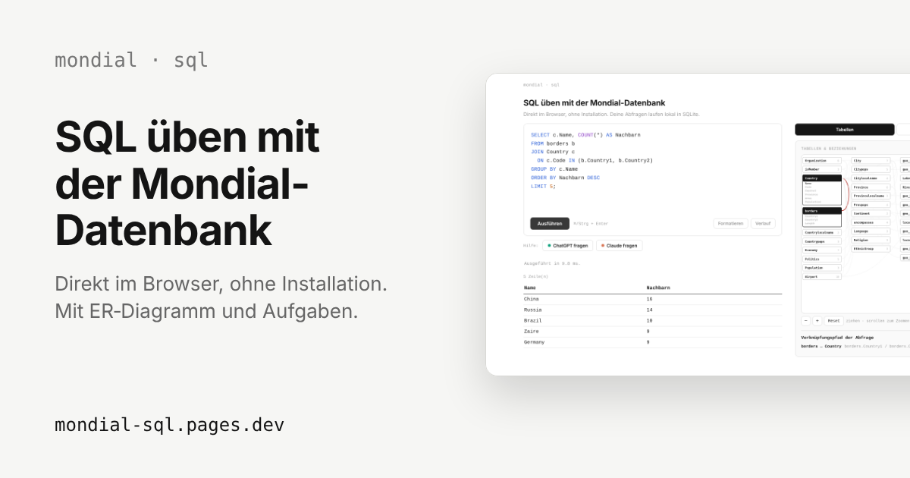

# Mondial SQL

**SQL üben mit der MONDIAL-Datenbank, direkt im Browser.**

👉 **Ausprobieren: [mondial-sql.pages.dev](https://mondial-sql.pages.dev)** · English: [mondial-sql.pages.dev/en/](https://mondial-sql.pages.dev/en/)



Viele Datenbank-Vorlesungen üben SQL mit MONDIAL, einer Geodatenbank mit Ländern, Städten, Flüssen, Bergen und Organisationen. Diese Seite lädt die komplette Datenbank in deinen Browser. Du schreibst Abfragen, siehst sofort das Ergebnis und erkennst im Diagramm, welche Tabellen du gerade benutzt. Installation und Konto brauchst du nicht.

## Was die Seite kann

- **Editor mit Syntax-Highlighting**, der mit der Abfrage wächst. Ausführen mit ⌘/Strg + Enter.
- **ER-Diagramm** aller 48 Tabellen. Die Tabellen und Verknüpfungen deiner Abfrage werden hervorgehoben.
- **„Meintest du …?“** schlägt bei Tippfehlern in Spalten, Tabellen und Schlüsselwörtern den richtigen Namen vor.
- **Formatieren** rückt die Abfrage sauber ein.
- **Verlauf** speichert deine letzten 50 Abfragen, blättern mit ⌘/Strg + ↑ / ↓.
- **ChatGPT fragen / Claude fragen** öffnet einen Chat mit deiner Abfrage, der Fehlermeldung und dem passenden Ausschnitt des Schemas.
- **[Übungsaufgaben](https://mondial-sql.pages.dev/aufgaben/)** mit Hinweisen und geprüften Lösungen, vom SELECT bis zur korrelierten Unterabfrage.
- **[Schema-Übersicht](https://mondial-sql.pages.dev/schema/)** mit allen Tabellen, Spalten, Schlüsseln und Verknüpfungen.
- Hell und dunkel umschaltbar.
- **Deutsch und Englisch.** Deutsch ist Standard. Wer im Browser kein Deutsch eingestellt hat, landet automatisch auf der englischen Fassung unter `/en/`. Die Wahl über den Umschalter oben wird gemerkt.

Die Abfragen laufen in **SQLite**. Falls deine Vorlesung Oracle nutzt: Dort heißt es `MINUS` statt `EXCEPT`, `NVL` statt `IFNULL` und `FETCH FIRST n ROWS ONLY` statt `LIMIT`.

## Deine Abfragen bleiben bei dir

Alle Abfragen werden nur in deinem Browser ausgeführt. Die Seite setzt keine Cookies und lädt nichts von fremden Servern. Erst wenn du auf „ChatGPT fragen“ oder „Claude fragen“ klickst, geht deine Abfrage an den gewählten Dienst.

## Für Entwickler

```
src/app.js           Editor, Ausführen, Diagramm, Vorschläge, Verlauf
src/i18n.js          Texte der App auf Deutsch und Englisch
src/er-data.js       Anordnung und Beziehungen der Tabellen im ER-Diagramm
src/theme.js         Hell/dunkel- und Sprachumschalter (alle Seiten)
src/formatter.js     Einstieg für sql-formatter (wird gebündelt)
web/index.html       Vorlage der Startseite
web/style.css        Styles für alle Seiten
web/site.mjs         Startseitentexte, FAQ und Tabellenbeschreibungen (de/en)
web/ui.mjs           feste Seitentexte und Pfade je Sprache
web/aufgaben.mjs     Übungsaufgaben (de/en)
web/public/          Favicon und Vorschaubilder (og.png, og-en.png)
data/mondial.sqlite  die Datenbank (SQLite)
data/schema.sql      Tabellendefinitionen für Diagramm und Schema-Seite
build.mjs            baut alles nach dist/
```

### Lokal starten

```sh
npm install
npm run preview        # baut dist/ und startet http://localhost:8080
```

Beim Build wird jede Musterlösung aus `web/aufgaben.mjs` gegen die Datenbank ausgeführt. Liefert eine Lösung einen Fehler oder keine Zeilen, bricht der Build ab.

### Deploy auf Cloudflare Pages

| Einstellung | Wert |
|---|---|
| Build command | `npm run build` |
| Build output directory | `dist` |
| Umgebungsvariable (optional) | `SITE_URL=https://deine-domain.de` |

`SITE_URL` legt die Adresse für Canonical-Links, Sitemap und Vorschaubild fest. Ohne die Variable gilt `https://mondial-sql.pages.dev`. Die Node-Version steht in `.node-version`.

Vorschaubild und Icons neu erzeugen (braucht Playwright für Python):

```sh
npm run build && python3 scripts/make_images.py
```

## Daten und Lizenzen

Der Code steht unter der [MIT-Lizenz](LICENSE).

Die Daten stammen aus der [MONDIAL-Datenbank](https://www.dbis.informatik.uni-goettingen.de/Mondial/) von Wolfgang May (Institut für Informatik, Universität Göttingen) und stehen unter [CC BY 3.0](https://creativecommons.org/licenses/by/3.0/deed.de). Grundlage der SQLite-Fassung ist [github.com/ullenboom/mondial-database](https://github.com/ullenboom/mondial-database). Zitiervorschlag des Autors:

> Wolfgang May: *Information Extraction and Integration with Florid: The Mondial Case Study.* Technical Report 131, Universität Freiburg, Institut für Informatik, 1999.

Verwendete Bibliotheken: [sql.js](https://github.com/sql-js/sql.js) (MIT), [sql-formatter](https://github.com/sql-formatter-org/sql-formatter) (MIT) und [esbuild](https://esbuild.github.io) (MIT).

Unabhängiges Projekt, nicht verbunden mit der Universität Göttingen.
